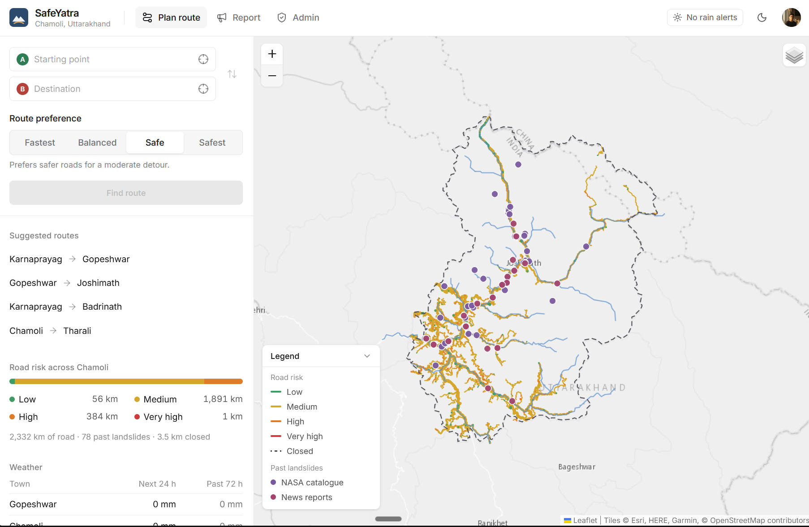
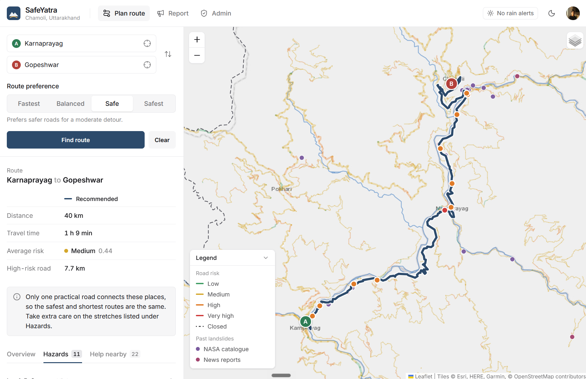
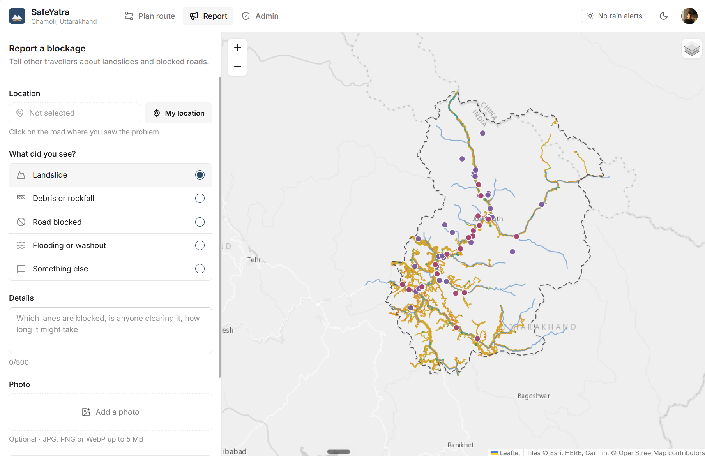

# SafeYatra

A hazard-aware route planner for the mountain roads of **Chamoli district, Uttarakhand**.
Every road segment gets a landslide / terrain risk score, and A\* routing balances
distance against safety with a "Fastest ↔ Safest" slider.

Full project context: `SAFEYATRA_FULL_CONTEXT.md` · Your to-do list: `YOUR_NEXT_STEPS.md`

## Screenshots

**Risk map of Chamoli.** Every road is coloured by landslide and terrain risk, alongside past
landslides, rivers, district risk totals and live weather.



**Route planning.** Karnaprayag to Gopeshwar, with distance, travel time, average risk and
high-risk road length. Dangerous stretches are marked along the route.



**Reporting a blockage.** Signed-in users mark a landslide or blocked road on the map, with an
optional photo. Admins verify reports, and verified reports close the road for routing.



## Run it (Windows)

You need two terminals: one for the backend and one for the frontend.

**Terminal 1: backend (FastAPI, port 8000)**
```powershell
cd C:\Users\Aditya\Desktop\gisproject\backend
..\.venv\Scripts\python.exe -m uvicorn app.main:app --reload --port 8000
```
API docs: http://127.0.0.1:8000/docs

**Terminal 2: frontend (React + Vite, port 5173)**
```powershell
cd C:\Users\Aditya\Desktop\gisproject\frontend
npm run dev
```
Open http://localhost:5173

Shareable route link example: http://localhost:5173/?from=Karnaprayag&to=Gopeshwar&safety=10

## First-time setup (already done on this machine)

```powershell
cd C:\Users\Aditya\Desktop\gisproject
py -3.12 -m venv .venv
.\.venv\Scripts\python.exe -m pip install -r requirements.txt
cd frontend
npm install
```

## Sign-in (Clerk), needed for reporting blockages and the admin page

1. Go to https://dashboard.clerk.com and sign up (free).
2. Click **Create application**, name it `SafeYatra`, choose sign-in options (e.g. Email + Google), and click **Create**.
3. Open **API keys**, then copy the **Publishable key** (starts with `pk_test_`).
4. Paste it in `.env` (project root): `VITE_CLERK_PUBLISHABLE_KEY=pk_test_...`
5. Restart both terminals.
6. Sign in to the app and open **Admin**. It shows your user id (`user_...`).
   Paste it in `.env` as `ADMIN_USER_IDS=user_...` and restart the backend.

Without a key the app still works: route search, risk map and weather are public.

## Updating the data

```powershell
.\.venv\Scripts\python.exe scripts\fetch_chamoli_data.py > run.json 2> run.log
```
Then restart the backend. If GSI Bhukosh files arrive, put them in `data/manual/`
(`gsi_susceptibility.geojson`, `gsi_landslides.geojson`). They replace the NASA map automatically.

## Tests

```powershell
cd backend
..\.venv\Scripts\python.exe -m pytest -q
```

## What is live and what is pre-computed

| Live (changes while the app runs) | Pre-computed (from `output/`) |
|---|---|
| Rain per town (Open-Meteo, hourly) → rain-adjusted risk + alerts | Base risk per road: susceptibility (NASA), past landslides, slope, bends |
| GSI landslide alert level (admin enters it) | Landslide points, rivers, streams, hospitals/police/fuel |
| Blockage reports (users) → verified ones close the road | Elevation, bends, river distance, travel-time estimates |
| Road closures with dates (admin) | Place names for search (OpenStreetMap) |
| Demo rain scenarios (admin, for dry-season demos) | |

## Project layout

```
backend/app/       FastAPI app: main.py (API), routing.py (A*), risk.py (live risk),
                   weather.py (Open-Meteo), store.py (SQLite), auth.py (Clerk)
backend/tests/     pytest tests (routing rules + API)
backend/storage/   SQLite database and uploaded photos (created on first run)
frontend/src/      React app: pages/ (Route, Report, Admin), components/ (map, panels)
scripts/           data pipeline (fetch_chamoli_data.py) and mockup generator
output/            generated GIS data the backend loads
data/              hand-made datasets (news landslides) and raw downloads
```

## Credits

© OpenStreetMap contributors (ODbL) · NASA Global Landslide Catalog and Global Landslide
Susceptibility Map (Stanley & Kirschbaum 2017) · Weather data by Open-Meteo.com (CC BY 4.0) ·
Terrain: Mapzen/Tilezen terrain tiles (SRTM).
